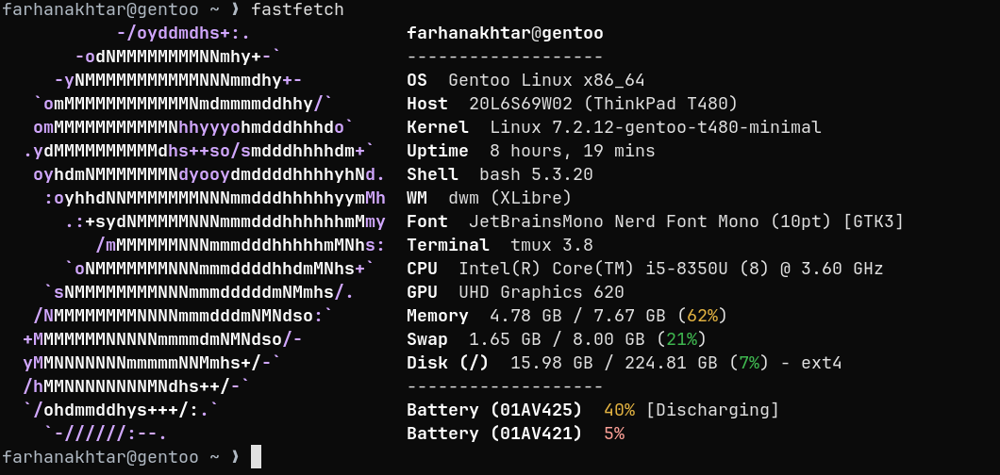

# T480 dotfiles

A monochrome, keyboard-driven Gentoo desktop for the ThinkPad T480. Built around a customized **dwm** and **st**, with Quickshell utilities, a practical terminal workflow, and a compact status bar.



<sub>Terminal and Fastfetch. This screenshot predates the shortened font label.</sub>


<sub>The current dwm bar, with workspace icons and live system status.</sub>

## The setup

| Component | Configuration |
| --- | --- |
| Window manager | Patched dwm with gaps, directional focus, floating and fullscreen windows |
| Terminal | st with JetBrainsMono Nerd Font and Noto Color Emoji fallback |
| Desktop utilities | Quickshell controls, clipboard history, app and file search, and shortcut guide |
| Shell and editor | Bash, tmux, Vis, fzf, zoxide, eza and bat |
| System tools | Fastfetch, btop, Wifitui and Bluetui |
| Desktop theme | Black and gray GTK, PCManFM and LibreWolf styling; colorful terminal and editor syntax |

The bar shows workspace icons, the focused window, Wi-Fi throughput, Bluetooth, volume, battery and time. Click Wi-Fi or Bluetooth to open their terminal interfaces; the other status items open the controls panel.

## Installation

Designed for **x86-64 Gentoo with OpenRC**. Start with a working Gentoo installation, network access, Git, sudo, a compiler and make. Run the installer as your normal user:

```sh
git clone https://github.com/farhanakhtar0x66/t480-dots.git ~/Projects/dotfiles
cd ~/Projects/dotfiles
./install.sh
```

The installer enables GURU if needed, accepts the Quickshell `~amd64` keyword, installs Gentoo dependencies, builds dwm, st and the desktop helpers, and installs the included fonts and configuration. It downloads pinned releases of fzf, zoxide, eza, bat, Bluetui and Wifitui and verifies their SHA-256 hashes. Replaced files are saved under `~/.local/state/dotfiles/`.

After installation, start a **new login shell** and run `startx`. Bash sets `XINITRC` to `~/.config/X11/xinitrc`.

> This is a personal T480 setup, not a distribution installer. A fresh-machine installation has not been tested. The script does not configure kernel options, a display manager, services, user groups or hardware permissions. Portage may require additional keyword, license or USE choices. LibreWolf, ChatGPT and LocalSend are optional and are not installed by the script.

To skip system package installation when all dependencies are already present, run `./install.sh --skip-system`.

## Key bindings

`Super` is the Windows key. Press **Super + K** for the searchable shortcut guide.

| Shortcut | Action |
| --- | --- |
| Super + Space | Search applications and files |
| Super + K | Search keyboard shortcuts |
| Super + Enter | Open a terminal |
| Super + E | Open the file manager |
| Super + 1–5 | Switch workspace |
| Super + Shift + 1–5 | Move the focused window to a workspace |
| Super + H / J / Up / L | Focus a window in that direction |
| Super + Shift + H / J / K / L | Move the focused window in that direction |
| Super + F | Toggle floating |
| Super + Shift + F | Toggle fullscreen |
| Super + T | Select the tiled layout |
| Super + Shift + R | Reload dwm |
| Print / Super + Print | Capture a selected window / the screen |
| Super + Shift + V | Open clipboard history |

The search panels support arrow keys, Enter and Escape. File search indexes up to 30,000 home-directory entries in a user-only cache under `~/.cache/t480-search`, excluding common caches, build directories and browser/Codex profile data.

## Clipboard and browser

In Vis, normal and visual `y` send the default yank to the X clipboard. In tmux copy mode, `y` and mouse selections copy through `xclip`; hold Shift while dragging to select through st itself.

The installer applies the LibreWolf styles when it finds exactly one `~/.config/librewolf/librewolf/*.default-release` profile. Otherwise, copy the files in [`browser/chrome/`](browser/chrome/) to the chosen profile's `chrome/` directory. Enable `toolkit.legacyUserProfileCustomizations.stylesheets` in `about:config` and restart LibreWolf. These styles cover browser chrome and internal pages, not arbitrary websites.

## Repository layout

```text
bin/          Session, search, clipboard and desktop helpers
browser/      LibreWolf chrome and internal-page styles
config/       Quickshell, Fastfetch, tmux, Vis, GTK and other settings
fonts/        Nerd Fonts and emoji fallback, with their licenses
icons/        Monochrome file-manager icons
shell/        Bash configuration
src/          Customized dwm and st, plus desktop helper sources
screenshots/  Desktop previews
install.sh    Gentoo installer
```

Configuration files are snapshots of the active setup. Edit them here and reinstall to apply changes. Hardware-specific settings, including the Wi-Fi interface, may need adjustment on another machine.
